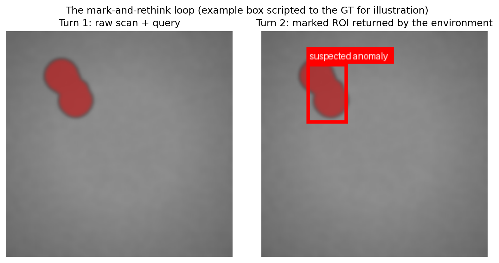
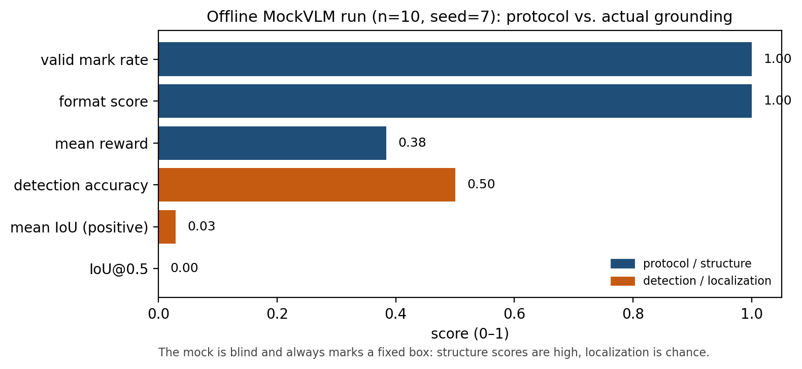

# roi-rethink

A small, runnable study of the two-turn **mark → rethink** loop from
**[BrReMark](https://github.com/fdu-farm/BrReMark)** — a VLM framework for
grounded anomaly detection in brain MRI.

I built this because I kept reading papers that add "reasoning" to a VLM and
report a better score, and I wanted to understand the mechanism well enough
to ask a sharper question: *does forcing the model to mark a region and look
at it again actually ground the answer, or does it just make the output look
more interpretable?*

BrReMark trains a 7B medical VLM (Lingshu) with SFT + GRPO on thousands of
clinical MRIs. I don't have the GPUs or the licensed data. So I rebuilt the
parts I could actually study on a laptop:

- the two-turn trajectory (`<think>` → `mark_bbox` → `<rethink>` → `<answer>`),
- the environment that draws the marked ROI and sends it back,
- the composite reward (format + IoU + optional LLM judge),
- and the synthetic-data trick where the judge is masked.

Everything runs offline with a `MockVLM`, in about a minute, with no API key.
See [`docs/BRREMARK_NOTES.md`](docs/BRREMARK_NOTES.md) for my
concept-by-concept notes.

> **What this is not:** a reproduction of BrReMark's clinical results. It is
> an educational re-implementation of its *mechanism*. The offline numbers
> below test the plumbing, not a model's medical ability.

## The loop I re-implemented

Turn 1 gives the model the raw image and the question. The model writes a
hypothesis and calls `mark_bbox`. The environment validates the call, draws
the box, and returns the **marked image** as the next observation. Turn 2
asks the model to re-examine that marked region and commit to an answer.

```
Turn 1   image + query  ->  <think> … </think>
                            <tool_call> mark_bbox [x1,y1,x2,y2] </tool_call>
Env      draw the box   ->  marked image (the "ROI rethink" observation)
Turn 2   marked image   ->  <rethink> … </rethink>
                            <answer> … </answer>
Reward   format + IoU(vs GT) + optional judge
```



*This example uses a scripted box equal to the ground truth so the figure can
show a successful turn-2 observation. It illustrates the interface; it is not
a model result.*

## What I ran, and what it taught me

### First run: the numbers looked fine, then they didn't

My first offline eval (`--mock --n 10 --seed 7`) gave:

| metric | value |
|---|---|
| mean reward | 0.487 |
| format score | 0.460 |
| valid mark rate | **0.100** |
| mean IoU (all samples) | 0.503 |
| IoU@0.5 | 0.000 |

A 0.50 mean IoU looks respectable, but a 0.10 valid-mark rate does not. When
I opened the per-sample records, only the **first** sample had ever produced
a `mark_bbox` call.

The bug was in my mock, not in the agent. `MockVLM` kept a global turn
counter: sample 0 consumed turns 1 and 2, so sample 1 was already on "turn 3"
and returned a turn-2 answer when the agent expected a turn-1 mark. Every
later sample fell through the invalid-mark path. The 0.50 IoU was mostly
*correct-rejection* credit on normal scans — the reward gives IoU = 1.0 when
there is no anomaly and the model marks nothing — not localization.

I made the mock stateless (it now infers the turn from the conversation
history) and made the environment/reward agree on the `[0,0,1,1]` "no
anomaly" sentinel. Then I re-ran the exact same command.

### After the fix

| metric | n=10, seed 7 | n=20, seed 7 |
|---|---|---|
| mean reward | 0.384 | 0.411 |
| format score | **1.000** | **1.000** |
| valid mark rate | **1.000** | **1.000** |
| mean IoU (positive scans only) | 0.029 | 0.076 |
| detection accuracy | 0.500 | 0.750 |
| IoU@0.5 | 0.000 | 0.000 |
| anomaly prevalence | 0.500 | 0.750 |



The protocol scores went to 1.00 because every sample now runs the full loop.
Localization stayed at chance — and that is the honest result, because
`MockVLM` is **blind**. It never sees the image; it always emits a fixed box.
Notice that detection accuracy equals anomaly prevalence in both runs. That
is the signature of a model that always says "yes": it is right exactly on
the positive cases and wrong on every normal scan.

I would rather publish an honest 0.03 than a flattering 0.50 that came from a
measurement bug. That was the most useful thing this project taught me.

### Sanity check: can the harness reach a perfect score?

`examples/quickstart.py` runs one sample with the GT box as a scripted mock
hint. It prints `format=1.00  iou=1.00  total=1.00`. That confirms the
environment, parser, and reward can reach full score when the mark is
actually right. It is a harness check, not evidence about a VLM.

## Quickstart (fully offline, no API key)

```bash
# 1. Environment (any Python >= 3.9; I tested 3.13)
conda create -n roi-rethink python=3.11 -y
conda activate roi-rethink

# 2. Install
pip install -r requirements.txt
pip install -e .

# 3. Tests (23 of them, all offline)
pytest tests/ -v

# 4. Generate a synthetic dataset
python scripts/generate_data.py --n 20 --out data/synthetic

# 5. Run the two-turn eval with MockVLM
python scripts/run_eval.py --mock --n 10 --seed 7 --out results/demo.json

# 6. Regenerate the README figures from the real code paths
python scripts/make_figures.py --out assets

# 7. Interactive demo (opens in your browser)
python scripts/demo_gradio.py
```

The eval writes per-sample records (turn-1 text, marked bbox, final answer,
reward breakdown) to `results/demo.json`, so I can inspect *why* a sample
scored what it did rather than only looking at the aggregate.

## With a real VLM

Any OpenAI-compatible vision endpoint works — OpenAI, Groq, Together, or a
local vLLM/Ollama server.

```powershell
# PowerShell (Windows)
$env:OPENAI_API_KEY = "sk-..."
$env:OPENAI_BASE_URL = "..."   # optional
python scripts/run_eval.py --model gpt-4o-mini --n 20 --out results/eval_real.json
python scripts/demo_gradio.py --model gpt-4o-mini
```

```bash
# bash
export OPENAI_API_KEY=...
export OPENAI_BASE_URL=...     # optional
python scripts/run_eval.py --model gpt-4o-mini --n 20 --out results/eval_real.json
```

A real model will not always follow the tool-call protocol; the agent retries
once, then falls back to a direct answer. Check `valid_mark_rate` before
trusting the other metrics. I have unit-tested the request formatting with a
fake client, but I have not run a paid API call in this repo, so I am not
claiming real-model numbers here.

## Project structure

```
roi_rethink/
├── agent.py        # two-turn RethinkAgent (hypothesis -> mark -> rethink -> answer)
├── env.py          # mark_bbox environment: validates, draws ROI, returns marked image
├── reward.py       # composite reward: format + IoU + optional masked judge (GRPO-style)
├── synthetic.py    # synthetic anomaly dataset (SynthSeg stand-in), deterministic, PIL-only
├── vlm.py          # VLM abstraction: OpenAI-compatible client + offline MockVLM
├── eval.py         # metrics + per-sample records
└── utils.py        # bbox IoU, tool-call parsing, ROI drawing
scripts/
├── generate_data.py
├── run_eval.py
├── make_figures.py
└── demo_gradio.py
examples/quickstart.py   # minimal end-to-end example
tests/                   # 23 offline pytest tests
docs/BRREMARK_NOTES.md   # concept-by-concept notes
docs/TUTORIAL.md         # setup -> results -> figures -> GitHub push
```

## The metrics, briefly

- **format score** — are the expected tags and a parseable `mark_bbox` call
  present? Weighted: valid tool call 0.35, answer 0.25, rethink 0.15, tool
  call 0.15, think 0.10.
- **IoU** — overlap between the marked box and the GT lesion box. On normal
  scans, *not* marking (or marking a tiny `[0,0,1,1]` sentinel) scores 1.0 as
  a correct rejection.
- **mean reward** — with the judge masked, `(0.3 * format + 0.5 * IoU) / 0.8`,
  mirroring BrReMark Phase 2 on synthetic data.
- **valid mark rate** — fraction of samples with a parseable turn-1 call.
- **detection accuracy** — did the model mark a meaningful ROI (> 4×4 px),
  compared with whether an anomaly is present? This is deliberately based on
  the tool call, not on parsing the free-text answer.
- **IoU@0.5** — fraction of positive scans with IoU ≥ 0.5.

## Tests and CI

`pytest tests/ -v` runs 23 tests: bbox IoU and clamping, tool-call parsing,
reward edge cases (perfect trajectory, masked judge, correct rejection,
sentinel, false positive), deterministic synthetic data, env feedback, mock
statelessness, eval metric consistency, OpenAI message normalization, and a
headless Gradio build. CI runs the suite on Python 3.9 and 3.11.

## The experiment I actually want to run next

The current numbers cannot answer the question I started with, because the
model is blind. The real experiment is an **ablation with the same real VLM
and the same test set**:

1. **one-shot** — image + question → answer (no mark, no second turn);
2. **two-turn** — the loop in this repo.

Compare mean IoU on positive scans, IoU@0.5, detection accuracy, and cost
(two-turn uses two model calls per sample). I would run at least 50 samples
and report a confidence interval, not a single mean. If the two-turn loop
does not beat one-shot with the same model, then the gain people attribute to
"rethinking" may just be extra test-time compute — and that is worth knowing.

I have not implemented the one-shot baseline yet. I would rather add it as a
separate, clearly named script than quietly change the existing agent.

## What I learned

- **The environment is the easy part; evaluation is where the bugs hide.** A
  global counter in a mock silently turned 9 of 10 samples into protocol
  failures and made mean IoU look far better than the localization it had.
- **A blind mock is great for plumbing and useless for claims.** It exercises
  parsing, drawing, reward aggregation, and JSON output. It says nothing
  about whether a VLM can localize a lesion.
- **The prompt and the reward have to agree.** My system prompt told the
  model to emit `[0,0,1,1]` for "no anomaly", while the reward treated any
  bbox as a false positive. One side had to change; I made the reward accept
  the sentinel and added a test for it.
- **Masking the judge on synthetic data is the right call.** There is no
  clinical truth in a noisy canvas; an unmasked LLM judge would reward
  confident-sounding hallucination.
- **Two turns cost two calls.** Any honest comparison has to pay for the
  one-shot baseline too.

## Credit

This is an independent educational project inspired by:

```bibtex
@misc{li2026enhancingbrainmrianomaly,
  title={Enhancing Brain MRI Anomaly Detection and Reasoning with ROI Rethink and Synthetic Data},
  author={Shangkun Li and Jie Xu and Yi Guo and Zeju Li and Yuanyuan Wang},
  year={2026},
  eprint={2606.25894},
  archivePrefix={arXiv},
  primaryClass={cs.CV}
}
```

BrReMark is built on [VeRL](https://github.com/volcengine/verl) and
[ViTAR](https://github.com/microsoft/ViTAR), uses the
[Lingshu](https://github.com/FLAIR-China/Lingshu) model and synthetic data
from [SynthSeg](https://github.com/BBillot/SynthSeg). None of those are
required here; this project is intentionally dependency-light.

## Author

**Naveed Ahmad** — I built this to learn how VLM grounding and RL-style
rewards fit together in medical imaging, as part of my work toward
trustworthy medical AI.

## License

MIT
